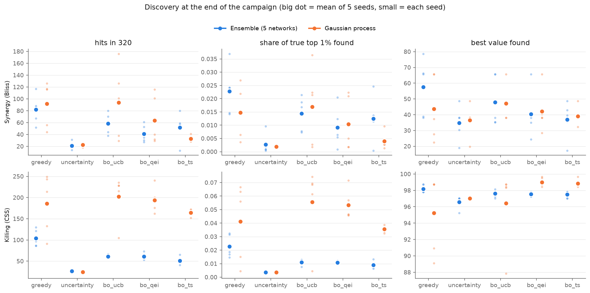
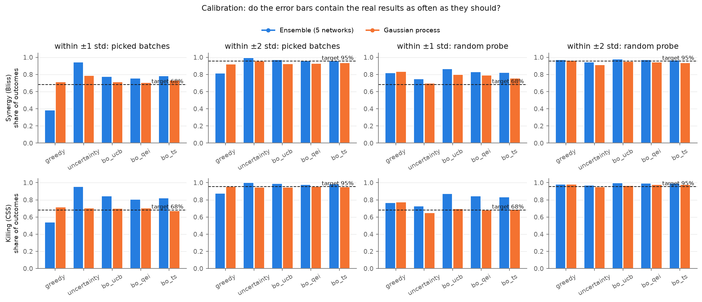

# The Gaussian-process surrogate: the main framework (and how it beat the ensemble)

> **Decision (2026-11-26): the Gaussian process (GP, `src/combo_agent/models/gp.py`) is the default
> surrogate for every campaign**, for both synergy and killing. The first surrogate, the
> 5-network ensemble, is the **legacy build**:
> - it lives in `src/combo_agent/models/legacy/`;
> - it runs only with `--surrogate ensemble`;
> - the git tag `ensemble-v1` marks the last state where it was the default.
>
> `runs/m4_main` (the M4 gate grid) was made with the ensemble.
>
> **Caveats that come with the decision:**
> - **Synergy:** the GP's advantage there is not established (a tie, §9.1).
> - **Prior mis-scaled:** its cell-lengthscale prior is mis-scaled for our inputs (§9.5; known-issues
>   **C4**). Fix it and re-race before relying on GP synergy results.
> - **Line concentration:** it concentrates picks in a few responsive cell lines (§9.4).
>
> See [`known-issues.md`](known-issues.md) (C4, C8, G1–G4).

*A from-zero walkthrough of the surrogate comparison, run 2026-11-25. Code locations are given as
file and function names under `src/combo_agent/`. They are relative to that folder unless they start
with another one.*

No background is assumed. Every abbreviation is spelled out the first time it appears, and there is a
glossary at the end (§12).

---

## 0. The answer first

| Question | Short answer |
|:--|:--|
| What did we do? | We built a second "prediction brain" (a **Gaussian process**) for the program that decides which lab experiments to run, and raced it against the existing brain (an **ensemble of 5 neural networks**) in 100 simulated lab campaigns. |
| Who won on the **killing** score? | **The Gaussian process, clearly.** With every smart picking rule it found 1.8× to 3.3× as many strong results within the same 320-experiment budget, on all 5 of 5 repeats. |
| Who won on the **synergy** score? | **Nobody, convincingly.** Results are within noise; one picking rule (Thompson sampling) did worse with the Gaussian process. |
| Are its error bars more honest? | **Yes.** When the Gaussian process says "I'm 68% sure the answer is in this range," it is right about 68–70% of the time. The ensemble says 68% but is right 84–87% of the time (it is too modest). |
| Why is synergy weak? | Most likely an **input-scaling mismatch**. The GP's default belief is "every cell line is unrelated to every other," and for synergy the data usually never overturns it. Campaigns where it *was* overturned did much better (§9.5). It's a small fix. |
| Any catch? | Yes. The Gaussian process wins partly by **camping in a few very responsive cell lines**. The pure "greedy" version spent 96–98% of its budget in a single cell line. That may or may not be what the project wants (§9.4). |
| Did we break the old system? | No. The old ensemble's 40 re-run campaigns are **row-for-row identical** to the earlier results. |

---

## 1. The project in one picture

The project builds a program that acts like a scientist with a limited lab budget. There are
**272,357 possible experiments**. Each experiment is a *triplet*: (drug A, drug B, cell line).

- A **cell line** is a population of cancer cells grown in the lab from one patient's tumour; we
  have 57 of them.
- Testing a drug pair on a cell line gives two numbers:
  - **Synergy** (the **Bliss** score, stored as `y_syn`): do the two drugs together do *more* than
    you'd expect from each alone? Big positive = the drugs help each other.
  - **Killing** (the **CSS** score, *combination sensitivity score*, stored as `y_inh` for
    "inhibition"): how strongly does the pair kill or stop the cells, regardless of why?
- A **hit** is an experiment in the top ~5% of all experiments: synergy ≥ 9.30 or killing ≥ 62.95
  (thresholds in `data_cache/processed/splits.json`).

All the real answers come from a public dataset (NCI-ALMANAC via DrugComb). They are **locked away**
in a "simulated lab" (the **oracle**, `lab/oracle.py`). The program only learns an answer by paying
to "run" that experiment.

```
               ┌────────────────────────── one campaign ──────────────────────────┐
               │                                                                   │
  32 free  ──► │  history of     ──► refit the   ──► predict all  ──► picking  ──► │ ──► pay for 16
  "seed"       │  revealed           SURROGATE       ~219,000         rule          │     experiments;
  results      │  results            (the brain)     untested         chooses 16    │     oracle reveals
               │      ▲                              experiments                    │     their results
               │      └─────────────────────── add the 16 new results ◄────────────┘
               │                     repeat 20 times = 320 paid experiments
```

**The goal:** find as many hits as possible within 320 paid experiments. A random picker finds about
16; that is the bar to beat.

> **Analogy.** Think of a treasure hunt on a huge field with 272,357 spots, and you're allowed to dig
> 320 holes. After every 16 holes you look at what you found and update your treasure map. The
> **surrogate** is the map. The **picking rule** is your strategy for choosing where to dig next.

---

## 2. What a "surrogate" is, and why its uncertainty matters

A **surrogate model** is a cheap stand-in for the expensive lab. You give it an untested experiment;
it gives back two numbers:

1. a **guess** (the *mean*): "I think the killing score will be about 55";
2. an **uncertainty** (the *standard deviation*, or *std*): "give or take about 12."

Both matter. If you only chase the best guesses, you keep digging near the treasure you already found
and never discover a better field. If you only chase uncertainty, you explore forever and never cash
in. The good picking rules (§6) balance the two, and they can only do that if the uncertainty is
**honest**:

- An uncertainty is *well calibrated* if "give or take 12" really means that about 68% of true answers
  land within ±12 of the guess. This is the fraction a bell curve puts within one standard deviation.
- An uncertainty should also **grow for experiments unlike anything tested yet**, and shrink near
  things we've tested.

In code, every surrogate returns a `Prediction` object (`models/prediction.py`). It holds
`mean_syn, std_syn, mean_inh, std_inh`, plus an optional split of the std into two parts:

- `latent_std`: the model's own doubt about the true average;
- `noise_std`: the lab's measurement scatter, which no amount of data removes.

---

## 3. The old brain: an ensemble of 5 neural networks

**What it is** (`models/legacy/ensemble.py`, `EnsembleModel`). A *neural network* is a flexible
function with thousands of adjustable numbers ("weights"). It is tuned by showing it examples until
its outputs match. We train **5** of them on the same revealed results. Each starts from different
random weights and holds out a different 20% of the data for "early stopping", which means stop
training when the held-out error stops improving.

**How it turns an experiment into numbers** (`models/features.py`, `FeatureSet.build`):

- each **drug** is described by
  - a *Morgan fingerprint*: 2,048 yes/no bits, each saying "this small chemical sub-structure is
    present";
  - its known protein **targets** (from the ChEMBL database);
- each **cell line** is described by gene **expression** (how active 1,000 genes are), mutations, and
  copy-number changes;
- the pair is fed in as `[f(A)+f(B), f(A)·f(B), g(line)]`, so swapping A and B changes nothing.

**Where its uncertainty comes from** (`predict`, `legacy/ensemble.py`): two sources.

1. **Disagreement.** If the 5 networks disagree about an experiment, we're unsure.
2. **A noise level.** This is estimated from held-out errors. It is added on top, because 5 networks
   often agree with each other even when they're all wrong.

> **Analogy.** Ask 5 friends who studied the same notes to guess a number. If they disagree, you know
> you're on shaky ground. But if they all copied the same mistake, they'll agree confidently and
> wrongly. The ensemble's uncertainty has this blind spot.

---

## 4. The new brain: a Gaussian process

### 4.1 The idea in one sentence

A **Gaussian process** (GP) assumes **similar experiments give similar results**. You tell it what
"similar" means, and it predicts an untested experiment as a **weighted blend of the tested
experiments that resemble it**. Its uncertainty is small near tested experiments and grows back to a
default level far from them.

```
 outcome
   ▲            tested ●                    ← far from any test: wide band (unsure)
   │        ╭──────●──────╮        ╭ ─ ─ ─ ─ ─ ─ ─ ╮
   │   ●───╯   narrow band ╰──●───╯   wide band     ╰─ ─
   │        (near tests: sure)
   └──────────────────────────────────────────────────►  "experiment space"
```

> **Analogy.** Estimating the price of a house. You look at sold houses that are *similar*: same
> street, same size, same age. If three near-identical houses next door sold for about $1M, you're
> confident. If the house is a castle in a town where nothing similar ever sold, you shrug: "somewhere
> between $300k and $5M." A GP does exactly this. The **kernel** (§4.2) is its definition of "similar
> house."

### 4.2 The kernel: our definition of "similar experiment"

The **kernel** is a function k(experiment₁, experiment₂) that returns a similarity score; 1 means
"same" and 0 means "unrelated." Ours is assembled from three building blocks, all defined in
`models/gp.py` (module docstring lines 17–32, code in `ComboKernel` at `gp.py`).

**Block 1: drug-to-drug similarity.**

```
k_drug(i, j) = π · Tanimoto(fingerprints) + (1 − π) · Tanimoto(target genes)
```

- **Tanimoto similarity** of two yes/no lists = (number of bits both have) ÷ (number of bits either
  has). For example, a drug with sub-structures {1, 2, 3} and one with {2, 3, 4} share 2 of 4: a
  Tanimoto of 0.5.
- It is computed with the **GAUCHE** library's `TanimotoKernel` (`gp.py`, `tanimoto`). GAUCHE is a
  library of GP tools for chemistry.
- **π** (`mix`) is learned from the data, between 0 and 1. It says how much to trust chemical
  structure versus shared targets.
- 30 of the 101 drugs have **no known target gene**. We set their target similarity to 1 with
  themselves and 0 with everyone else (`gp.py`). Otherwise every pair of untargeted drugs would
  look identical.

**Block 2: pair-to-pair similarity (order-free).**

```
k_pair((a,b), (a',b')) = k_drug(a,a')·k_drug(b,b') + k_drug(a,b')·k_drug(b,a')
```

Two pairs are similar if their drugs match up in either order. "Aspirin + X" and "X + aspirin" are
the same pair.

**Block 3: cell-line similarity.**

- Each cell line's 1,000 gene-expression values are compressed to **16 summary numbers** with
  **principal component analysis** (PCA): a standard way to find the few directions along which the
  57 lines differ most (`gp.py`, `GPFeatures.build`).
- Similarity is then a **Matérn kernel** on those 16 numbers: close in the 16-number space means
  similar, and similarity fades smoothly with distance.
- Each of the 16 directions gets its own **lengthscale**, learned from data. This is "how far you
  must move along this direction before two lines stop resembling each other." A short lengthscale
  means lines are treated as nearly unrelated; a long one means lines share information.

**Putting them together:**

```
Synergy:  similarity = s_int × k_pair × k_cell
Killing:  similarity = s_int × k_pair × k_cell
                     + s_single × [k_drug(a,a') + k_drug(a,b') + k_drug(b,a') + k_drug(b,b')] × k_cell
```

- `s_int` and `s_single` are learned "volume knobs."
- The extra killing term encodes "**each drug kills on its own**," whatever its partner. Killing has
  a large single-drug part; synergy (Bliss) has that part already subtracted out by definition, so it
  doesn't get the term (`SINGLE_DRUG_TERMS`, `gp.py`).
- There is **no dose input**: our outcomes are one summary number per experiment, not dose curves.

### 4.3 Noise: the lab is not perfectly repeatable

The GP also learns a **noise level** σ², the scatter you'd see if you ran the same experiment twice.
Some experiments were measured twice and averaged, which makes them more reliable, so their noise is
divided by 2 (`RepNoise`, `gp.py`).

### 4.4 Fitting: tuning the knobs

The learnable knobs are:
- π (structure vs targets);
- the 16 cell lengthscales;
- `s_int` and `s_single`;
- the noise σ²;
- a constant baseline.

They're set by maximizing the **marginal likelihood**: "how probable would the data we've seen be,
if these knob settings were true?" This has a built-in **Occam's razor**. Settings that are too
flexible spread their bets over too many possible worlds and score lower, so the GP doesn't overfit
easily, even with only 32 data points.

In code (`_fit_target`, `gp.py`):
- the optimizer is BoTorch's L-BFGS-B fitter, run from **5 starting points**: one at sensible
  defaults and four random draws from mild **priors** (`_init`, `gp.py`);
- the best-scoring start wins;
- everything uses 64-bit numbers for numerical safety.

The same code is used for both outcomes, but **each outcome gets its own independent GP**
(`fit_frame`, `gp.py`, loop over `TARGETS`).

### 4.5 Predicting 219,000 experiments in about a second

A textbook GP prediction needs the similarity between every candidate and every tested experiment.
That is about 219,000 × 352 numbers. We do this in chunks with small lookup tables (`_Fit.cross`,
`gp.py`). Drug pairs repeat across the 57 lines, so pair similarities are computed once per unique
pair and reused. Then the standard formulas run (`_posterior`, `gp.py`):

```
guess       = baseline + (similarity to tested) · (weights solved from tested results)
uncertainty = prior uncertainty − (how much the tested experiments explain)
```

A unit test checks that our hand-written formulas match GPyTorch's official ones to 0.01% (§8).

---

## 5. One plug, two brains: the surrogate interface

To compare fairly, the *only* thing that may differ between the two arms of the race is the brain. So
both brains expose the same four methods (`models/surrogate.py`, `Surrogate`):

| Method | What it gives the picking rules | Ensemble | Gaussian process |
|:--|:--|:--|:--|
| `fit(history)` | learn from revealed results only | `legacy/ensemble.py` | `gp.py` |
| `predict(experiments)` | guess + uncertainty for both outcomes | `legacy/ensemble.py` | `gp.py` |
| `sample(experiments, n, …)` | *n* plausible "possible worlds" of outcomes (for §6's sampling rules) | one random network + noise (`legacy/ensemble.py`) | true joint draw from the GP (`gp.py`) |
| `similarity(experiments)` | how alike two candidates are (for the variety bonus) | cosine of the networks' internal features (`legacy/ensemble.py`) | the GP's own kernel, normalized (`gp.py`) |

`make_surrogate("gp" | "ensemble", …)` (`surrogate.py`) builds either. The command line picks one
with `--surrogate` (default `gp`).

> **Why `fit` takes oracle `Result` objects, not a raw table.** It makes it impossible for a picking
> rule to slip the model answers from anywhere except the simulated lab. That's a safety lock against
> accidentally "peeking" at hidden answers.

> **Analogy.** A games console and two cartridges. The console (runner + picking rules) doesn't care
> which cartridge (surrogate) is plugged in, as long as it has the same connector.

---

## 6. The picking rules (selectors)

All in `selectors/baselines.py`. Each round, a rule sees every untested candidate with the brain's
guess and uncertainty, and returns 16 experiments.

| Rule | Plain-language strategy | Code |
|:--|:--|:--|
| `random` | Pick 16 at random. The bar to beat. | `baselines.py` |
| `greedy` | Pick the 16 best guesses. Pure exploitation. | `baselines.py` |
| `uncertainty` | Pick the 16 we're most unsure about. Pure exploration. | `baselines.py` |
| `bo_ucb` | Score = guess + 2 × uncertainty ("optimism"). Take the top 2,000, then pick 16 that score well **and aren't too similar to each other**. | `baselines.py`, variety logic `diverse_greedy` at `:89` |
| `bo_qei` | Imagine 128 possible worlds (`sample`). Pick the batch that most raises the **expected best result found so far**, averaged over those worlds. | `baselines.py` |
| `bo_ts` *(new)* | **Thompson sampling.** For each of the 16 slots, imagine *one* possible world and take its best experiment. Optimism comes for free: an uncertain experiment sometimes looks great in an imagined world. | `baselines.py` |

"**BO**" = **Bayesian optimization**: using a model with uncertainty to decide where to look next.
**UCB** = *upper confidence bound* (the "guess + 2 × uncertainty" score). **qEI** = *batch (q
experiments at a time) expected improvement*.

> **Analogy.** Choosing restaurants in a new city. Greedy always goes to the best-rated place you know.
> Uncertainty goes wherever you know least, even if it's probably bad. UCB says "the best *it could
> plausibly be*." Thompson sampling rolls a die on each place's possible quality and goes where the
> roll came out best.

---

## 7. The race: making it fair

### 7.1 What was run

`eval/runner.py`. The grid preset `gpcompare` (`runner.py`) runs:
- 5 picking rules (`greedy`, `uncertainty`, `bo_ucb`, `bo_qei`, `bo_ts`);
- × 2 outcomes (synergy, killing);
- × 5 **seeds** (0–4);

that is **50 campaigns per brain, 100 in total**. A *seed* is a different starting draw: a different
set of 32 free results, and different random numbers. Running several seeds tells us how much
results vary by luck.

`random` doesn't use a brain, so it's reused from the earlier M4 run (seeds 0–4): **15.2 killing
hits, 16.2 synergy hits** on average.

### 7.2 The campaign loop in code

`run_campaign`, `eval/runner.py`:

| Step | What happens |
|:--|:--|
| set up the lab | `Oracle.from_cache(seed=…)` reveals the 32 free seed results |
| fix the dice | the picking rule's random numbers depend only on (seed, rule, outcome), not on the brain |
| loop | `while oracle.budget_left() > 0` (20 rounds) |
| refit the brain | `make_surrogate(surrogate, features, seed=seed*1000+round).fit(oracle.history())` |
| predict | `model.predict(cand)` for every untested candidate |
| pick | `selector.select(ctx, 16, target, rng)` |
| log diagnostics | predictions for the batch and for a fixed random "probe" set (§7.4) |
| pay and reveal | `oracle.run(batch)` |
| record | hits so far, timings (`_round_row`, `runner.py`) |

### 7.3 Proof that the old brain still behaves exactly the same

Before touching any code, a slice of the old ensemble runs was re-run and matched row for row
(a rerun before any GP code was added). After the refactor (the ensemble gained `sample()` and `similarity()`), **all 40
ensemble campaigns that also exist in the earlier M4 run were again identical**: same 352 revealed
experiments, same order. Only the 10 new `bo_ts` campaigns have nothing to compare against.

This matters because it means any difference in the race comes from the GP, not from a change we
made by accident to the ensemble side.

**Again on 2026-11-26**, when the GP became the default and the ensemble moved to
`models/legacy/`, two campaigns were rerun and matched their archived runs row for row:
- `bo_ucb` × synergy × seed 0 with no `--surrogate` flag, i.e. the new GP default, against
  `runs/gp_compare/gp`;
- the same campaign with `--surrogate ensemble`, against `runs/m4_main`.

The move changed no numbers.

### 7.4 Diagnostics that don't disturb the race

`eval/diagnostics.py`. Each round, the runner records each brain's predictions for two sets:

- the **batch** it picked. These answers are revealed anyway, but the set is biased, because picks
  are deliberately extreme;
- a fixed **probe** of 2,000 random experiments, the same for every rule and brain within a seed
  (`probe_keys`, `diagnostics.py`). This is unbiased. It's drawn from its own random-number
  stream, so logging it can't change any pick (a test checks this).

It also records **distance to the nearest tested experiment** (`DistanceSpace`, `diagnostics.py`).
This uses a ruler that belongs to neither brain: fingerprint similarity of the drugs × expression
similarity of the lines. That's how we test "does uncertainty grow far from the data?" fairly for
both.

---

## 8. How we test that the GP code is right

`tests/test_gp.py` (7 tests). The full suite: **204 passed, 30 skipped** (after the GP became the default).

- **Matches the reference library.** Our fast prediction formulas agree with GPyTorch's exact
  posterior on the same knob settings (mean to 1e-4 sd, std to 0.1%).
- **Recovers a planted pattern.** On a made-up world with 3 chemical families and a known rule, the
  fitted GP comes close to the best possible GP (the one given the true knob settings).
- **Order doesn't matter.** (A, B) and (B, A) get the same prediction.
- **Safety.** It refuses histories above 5,000 rows: an exact GP becomes too slow there, and a
  *sparse* approximation would be needed (not built; campaigns stop at 352).
- **Diagnostics don't change the picks** (the probe has its own random numbers).

---

## 9. Results

All numbers are means over 5 seeds. "5/5" means the GP beat the ensemble on every seed.

**A note on statistics.** With 5 seeds, the usual paired test (the *Wilcoxon signed-rank test*) cannot
give a p-value below 0.0625, even when one side wins all 5. So we judge by:
- the **bootstrap 95% confidence interval** of the per-seed difference: if it excludes 0, it's
  called a win;
- how many seeds agree.

That is honest but weak evidence; 10 seeds would be better (§11).

### 9.1 Discovery: hits found within 320 paid experiments



**Killing (CSS).** Random finds 15.2.

| Rule | Ensemble | GP | GP better by (95% CI) | Seeds GP better |
|:--|--:|--:|--:|:--:|
| greedy | 104.2 | **186.0** | +81.8 (+33 to +130) | 5/5 |
| uncertainty | 26.6 | 24.2 | −2.4 (−4.0 to −0.6) | 0/5 |
| bo_ucb | 60.8 | **202.2** | +141.4 (+90 to +173) | 5/5 |
| bo_qei | 61.2 | **193.6** | +132.4 (+111 to +162) | 5/5 |
| bo_ts | 51.2 | **164.4** | +113.2 (+106 to +122) | 5/5 |

**Synergy (Bliss).** Random finds 16.2.

| Rule | Ensemble | GP | GP better by (95% CI) | Seeds GP better |
|:--|--:|--:|--:|:--:|
| greedy | 82.0 | 91.8 | +9.8 (−16 to +36) | 2/5 |
| uncertainty | 20.8 | 22.6 | +1.8 (−3.8 to +7.4) | 3/5 |
| bo_ucb | 58.4 | 94.0 | +35.6 (−6 to +75) | 3/5 |
| bo_qei | 41.2 | 63.6 | +22.4 (+1 to +45) | 3/5 |
| bo_ts | **51.6** | 32.6 | −19.0 (−36 to +1.6) | 1/5 |

**What the numbers mean.**

- **Killing.** The GP finds roughly **3×** as many top-5% experiments with the BO rules, and it found
  ~5% of the true top-1% killing experiments versus ~1% for the ensemble.
- **Synergy.** Seed-to-seed variation is huge: GP `bo_ucb` ranges from 29 to 176 hits. No difference
  is reliable.
- **`uncertainty` is barely better than random for both brains.** Pure exploration doesn't pay on a
  budget this small.
- **One weakness, best value found.** GP greedy on killing twice got stuck below the ensemble's best
  value (89 and 91 vs ~98).

### 9.2 Honest error bars (calibration)



On the unbiased random probe, the share of true answers within ±1 std should be **68%**:

| Killing, ±1 std, probe | Ensemble | GP |
|:--|--:|--:|
| bo_ucb | 0.87 | 0.70 |
| bo_qei | 0.85 | 0.68 |
| bo_ts | 0.84 | 0.69 |

- **The ensemble's error bars are too wide.** It is *under-confident*.
- **The GP is almost exactly right on killing** and slightly wide on synergy (0.76–0.80).
- **Negative log-likelihood.** This is a single score that punishes both wrong guesses and dishonest
  error bars; lower is better. The GP is lower in all 10 rule × outcome comparisons on the picked
  batches, and in 8 of 10 on the random probe; the other 2 are ties.

> **Why under-confidence hurts.** With UCB ("guess + 2 × uncertainty"), inflated uncertainty makes
> the rule chase experiments that are merely unfamiliar rather than promising. Inflated error bars
> are expensive in a budgeted search.

### 9.3 Does uncertainty grow far from the data?

We measured this with a **Spearman correlation**: a −1 to +1 score of how well two rankings agree,
here the ranking by uncertainty and the ranking by distance to the nearest tested experiment.

- **Killing.** GP 0.32–0.54 (`uncertainty`, `bo_ucb`, `bo_qei`, `bo_ts`); ensemble 0.06–0.12. The
  GP's uncertainty behaves as it should; the ensemble's barely tracks novelty.
- **Synergy.** Both about 0 (−0.02 to 0.18). Neither brain's synergy uncertainty knows what's novel.
  For the GP we know why (§9.5).

### 9.4 The catch: *where* the GP's hits come from

A hit is defined against **one cutoff for the whole pool**, so some cell lines are hit-rich. For
killing, two lines clear the cutoff in **33%** of their experiments, while the median line does so in
**3%**. A strategy that finds a very sensitive line and stays there can score many "hits." We
therefore counted where each campaign's hits came from (a post-hoc analysis of the revealed
experiments, run after the campaigns finished; it is not part of the package).

| Killing, mean per campaign | Hits | Distinct hit **pairs** | Lines with hits | Share of picks in the single most-picked line |
|:--|--:|--:|--:|--:|
| greedy, ensemble | 104 | 56 | 19 | 26% |
| greedy, GP | 186 | 186 | **1.6** | **98%** |
| bo_ucb, ensemble | 61 | 38 | 18 | 16% |
| bo_ucb, GP | 202 | 133 | 10 | 43% |

The two brains concentrate in **opposite ways**:

- **Ensemble greedy** repeats a few strong drug pairs across many lines. On synergy: 82 hits from
  only 23 distinct pairs.
- **GP greedy** sweeps hundreds of different pairs inside one very responsive line.

Is the GP's advantage *only* line-camping? We split each campaign's success into two factors:

- **Line choice** = how hit-rich the chosen lines are, compared with random lines.
- **Pair choice** = hits found ÷ hits expected if the same lines had been picked but with random
  pairs inside them.

| Killing | Line choice (ensemble → GP) | Pair choice (ensemble → GP) |
|:--|:--:|:--:|
| greedy | 3.3× → 4.7× | 2.0× → 3.0× |
| bo_ucb | 2.4× → 4.3× | 1.7× → 3.1× |
| bo_qei | 2.2× → 4.5× | 1.8× → 2.9× |
| bo_ts | 2.0× → 4.1× | 1.6× → 2.6× |

**Reading this.** The GP is better at **both**. It picks more responsive lines *and*, within those
lines, picks pairs that hit about 3× as often as chance (vs about 1.7× for the ensemble). So the
advantage is real, not only a quirk of the metric. Still, a campaign that tests 186 pairs in one cell
line says little about *which other lines* would respond. That is exactly what the project's second
research question (mechanistic predictions on held-out lines) needs.

### 9.5 What the GP actually learned (its fitted knobs)

We refit the GP on each `bo_ucb` campaign's history at two points: the start (32 results) and the
end (352 results). This covers all 5 seeds and both outcomes.
(This was a post-hoc refit from the saved histories; it is not part of the package.)

The headline knob is the **median cell lengthscale**. It decides whether the GP thinks cell lines
resemble each other. 0.82 means "every line is unrelated"; 4 or more means lines share information.

| | Start of campaign (32) | End of campaign (352) | Hits at 320 |
|:--|:--|:--|:--|
| Killing, seeds 0–3 | 0.82 (unrelated) | 4.4–8.2 (lines share; median line similarity 0.19–0.49) | **215–235** |
| Killing, seed 4 | 0.83 (unrelated) | 0.86 (still unrelated) | **105** |
| Synergy, seeds 1, 3 | 0.82 (unrelated) | 8.4–8.6 (lines share; similarity 0.45–0.70) | **126, 176** |
| Synergy, seeds 0, 2, 4 | 0.82 (unrelated) | 0.81–0.82 (still unrelated; noise = 74–93% of variance) | **101, 38, 29** |

**What it means.** The single best predictor of whether a GP campaign does well is whether the GP
**ever learns that cell lines resemble each other**. Every campaign *starts* believing they don't.

There's a correlation caveat: a lucky campaign also produces data that reveals line structure more
easily, so cause and effect run both ways. Still, the pattern is consistent across both outcomes.

**Why does the GP start out thinking lines are unrelated? We found a concrete cause.**

- The lengthscale prior we used is BoTorch's default, LogNormal(√2 + ln(16)/2, √3). It was designed
  for inputs squeezed into a 0–1 box, where two random points are typically about **1.6** apart.
- Our cell inputs are *standardized* principal components. There, two lines are typically **5.6**
  apart, and even the two closest lines are 1.72 apart.
- The prior's most likely value (its *mode*) is a lengthscale of **0.82**. At that lengthscale, two
  lines at the typical distance have similarity **0.000**. At 4 it would be 0.32; at 8, 0.71.
- When the data is too weak to argue, the fit settles exactly at the prior's mode: 0.82, which is
  what we observe. That always happens at 32 results, and for synergy usually all the way to 352.

In short, an **input-scaling mismatch** makes "all lines unrelated" the GP's default belief.

**Other knobs.**
- **π** (structure vs targets) is undetermined at 32 results: it lands at 0 or 1. At 352 results it
  is 0.71–1.0, so shared target genes get little weight.
- **Noise share** varies a lot between seeds (killing 0.03–0.87). The fit sometimes lands in an
  "explain it all as noise" solution, which is the same story told from the other side.

**A second, separate suspicion (not tested).** Synergy has large per-line offsets: some lines show
more synergy for almost any pair. Our synergy kernel has no "this line is synergistic in general"
term, so such an offset can only spread through pairs that share a drug.

### 9.6 Speed

Fit times were measured on an idle machine (`fit_time_benchmark.csv`, 3 histories × 4 sizes):

| Experiments in history | 32 | 96 | 192 | 352 |
|:--|--:|--:|--:|--:|
| Ensemble refit (s) | 8.6 | 16.1 | 21.3 | 24.3 |
| GP refit, both outcomes (s) | 5.2 | 6.8 | 12.1 | 25.2 |

- **About equal at our scale.** The GP's cost grows roughly with the cube of the history size, so it
  would fall behind beyond a few hundred more experiments. At 5,000 it refuses and would need a
  sparse approximation.
- **Prediction of all ~219k candidates.** GP about 1.3 s vs ensemble about 2.2 s per round.

---

## 10. So what? Recommendation

1. **Use the GP as the default brain for killing.** It wins by a wide margin on every BO rule, on
   every seed, with better-calibrated error bars and uncertainty that tracks novelty.
2. **Fix the input-scaling mismatch before anything else.** Either rescale the 16 cell numbers into
   a 0–1 box (what the default prior expects), or keep them standardized and move the lengthscale
   prior to match. It's a one-line change in `GPFeatures.build` (`gp.py`) or in the prior
   (`gp.py`). It should help most where the GP is weakest: synergy, and the start of every
   campaign. Until this has been re-raced, read GP synergy results with caution. (The GP was made the default for both outcomes anyway on 2026-11-26.)
3. **Make line diversity explicit.** Decide whether hits concentrated in one or two cell lines count
   fully. Report *distinct pairs* and *lines covered* next to raw hits in every future comparison,
   and consider a per-line cap or a line-aware variety bonus. Otherwise a brain can win the metric by
   camping.
4. **Prefer `bo_ucb` with the GP** as the numeric baseline for the agent (M6) to beat. It is the
   strongest GP rule on both outcomes and keeps more line diversity than greedy (10 lines vs 1.6).

---

## 11. What's left

| # | Item | Status / cost |
|:--|:--|:--|
| 1 | The 100-campaign comparison grid, comparison tables, figures, exact-reproduction check, idle fit-time benchmark | **Done** (2026-11-25) |
| 2 | **Fix the cell-input scale / lengthscale prior** (§9.5); re-race the GP on seeds 0–4 | Not built. Small code change + a test; ~5–6 h of GP campaigns (or ~1 h for a `bo_ucb`-only check) |
| 2b | Then, only if synergy is still weak: a **per-line baseline term** (`s_line × k_cell`) | Not built. ~1 h code + tests |
| 3 | **Seeds 5–9 for statistical power.** The ensemble already has seeds 5–9 for 4 rules in `runs/m4_main`, so only the 40 GP campaigns + 10 ensemble `bo_ts` are new | ~6 h |
| 4 | Add *distinct hit pairs* and *lines covered* to `eval/compare.py`'s report (so far only in a post-hoc analysis) | small |
| 5 | Decide the surrogate for M6 (recommendation above) | **Decided 2026-11-26: the GP is the default for both outcomes.** The ensemble is the legacy build |
| 6 | Docs: this note and a CHANGELOG entry | **Done** (2026-11-26) |
| 7 | Commit the GP work | **Done**: branch `m2-m5`; ensemble state tagged `ensemble-v1` |

---

## 12. Glossary

| Term | Meaning |
|:--|:--|
| **Bliss** | A synergy score: observed effect of the pair minus the effect expected if the drugs acted independently. Our `y_syn`. |
| **BO (Bayesian optimization)** | Choosing the next experiments using a model that has uncertainty. |
| **Bootstrap CI** | A 95% confidence interval made by resampling the seeds many times. |
| **Calibration** | Whether stated uncertainty matches reality (68% of answers within ±1 std). |
| **Cell line** | Cancer cells from one tumour, grown in the lab. 57 here. |
| **CSS** | Combination sensitivity score: how strongly a pair kills or stops cells. Our `y_inh`. |
| **Ensemble** | Several models trained separately; their disagreement measures uncertainty. |
| **GP (Gaussian process)** | A model that predicts by blending similar tested examples; similarity is set by a kernel. |
| **Hit** | An experiment in the top ~5% of the pool on the chosen outcome. |
| **Kernel** | The GP's similarity rule between two inputs. |
| **Lengthscale** | How far apart two inputs can be (along one direction) and still be considered similar. |
| **Marginal likelihood** | How probable the observed data is under given kernel settings; used to tune them. |
| **Matérn kernel** | A standard smooth similarity rule on numeric inputs. |
| **NLL (negative log-likelihood)** | One number scoring guesses *and* error bars together. Lower is better. |
| **Oracle** | The simulated lab that holds the hidden answers. |
| **PCA (principal component analysis)** | Compresses many numbers (1,000 genes) into a few summary directions (16). |
| **Seed** | One independent repeat of a campaign with a different start. |
| **Spearman correlation** | How well two rankings agree, from −1 to +1. |
| **Std (standard deviation)** | The "give or take" size of an uncertainty. |
| **Surrogate** | The cheap stand-in model for the lab (the "brain"). |
| **Tanimoto similarity** | Shared yes-bits ÷ bits present in either; 0 to 1. |
| **Thompson sampling** | Imagine one plausible world from the model and act as if it were true. |
| **UCB (upper confidence bound)** | Guess + β × uncertainty: an optimistic score. |

## Appendix: concept → code map

| Concept | File | Functions and classes |
|:--|:--|:--|
| The simulated lab | `lab/oracle.py` | `Oracle`, `candidate_frame`, `run`, `history`, `is_hit` |
| Prediction object | `models/prediction.py` | `Prediction`, `.ucb` |
| Ensemble brain | `models/legacy/ensemble.py` | `EnsembleModel`, `fit_frame`, `_train`, `predict`, `sample`, `similarity` |
| Ensemble inputs | `models/legacy/ensemble_features.py` | `FeatureSet.build`, `pair_block` |
| GP inputs | `models/gp.py` | `tanimoto`, `GPFeatures.build` |
| GP kernel | `models/gp.py` | `ComboKernel`, `tables`, `forward` |
| GP noise | `models/gp.py` | `RepNoise` |
| GP fitting | `models/gp.py` | `fit_frame`, `_fit_target`, `_init` |
| GP prediction | `models/gp.py` | `_Fit.cross`, `_posterior`, `predict`, `sample`, `similarity` |
| Common plug | `models/surrogate.py` | `Surrogate`, `make_surrogate` |
| Picking rules | `selectors/baselines.py` | `GreedySelector`, `UncertaintySelector`, `diverse_greedy`, `UCBSelector` (bo_ucb), `greedy_qei`, `QEISelector` (bo_qei), `ThompsonSelector` (bo_ts) |
| Campaign loop | `eval/runner.py` | `GRIDS`, `run_campaign`, `run_one` |
| Diagnostics | `eval/diagnostics.py` | `DistanceSpace`, `probe_keys`, `round_records` |
| Scoring and statistics | `eval/compare.py` | `calibration`, `per_run`, `paired`, `report`, `benchmark_fit` |
| Figures | `scripts/make_gp_comparison_figures.py` | |
| Tests | `tests/test_gp.py` | |
