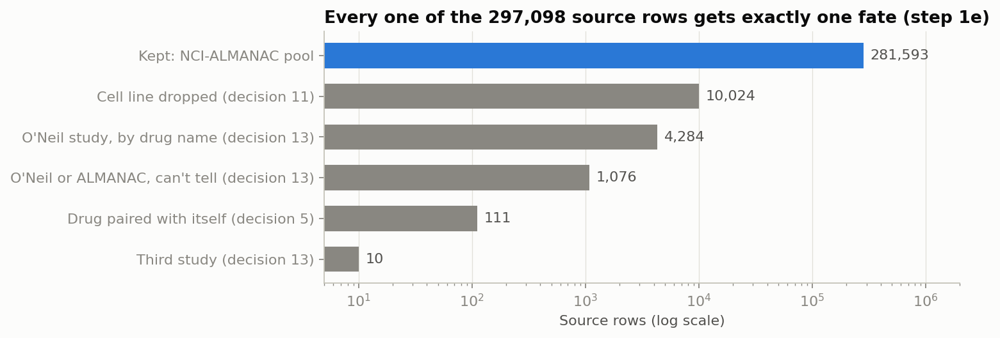
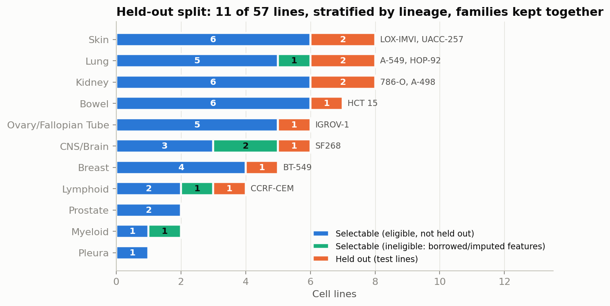
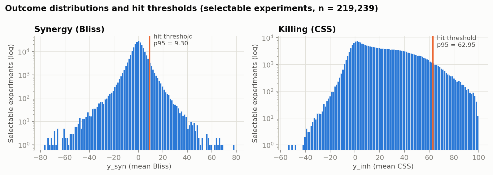
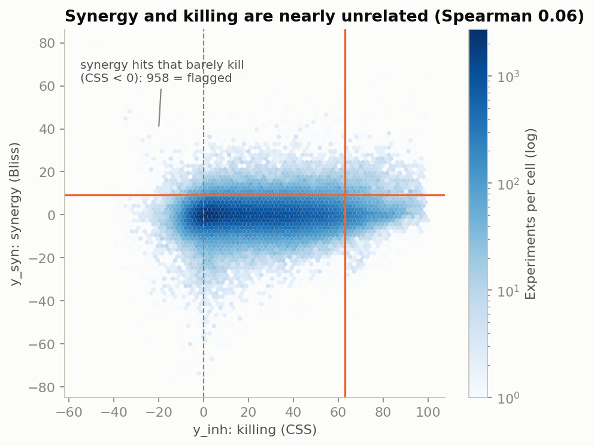
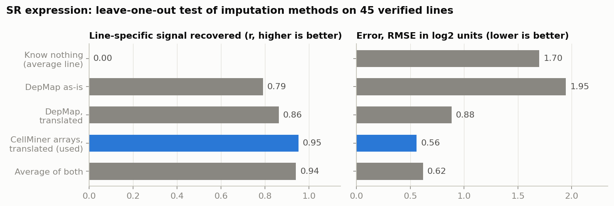

# M1 complete: what we built, every decision, and the frozen pool

Status: **M1 (data and pool) is built and frozen** (2026-11-08).
This page explains, for a newcomer:
- what the pool is;
- every decision taken on the way, and why;
- how the cell lines were split;
- what "a hit" means;
- what to be careful about when using the data.

Figures are regenerated by [`scripts/make_m1_figures.py`](../../scripts/make_m1_figures.py). Every
number comes from the frozen outputs in `data_cache/processed/` of the code repo:
`data_card.md`, `splits.json` and `freeze_report.json`.

---

## 1. The big picture

The project needs a **simulated lab**. It's a big table of drug-combination experiments whose
results are hidden until an agent "runs" one. M1 builds that table from the public NCI-ALMANAC
screen, and attaches a description to every drug and every cell line so a model can generalise.

```
 raw TDC file (297,098 rows)
   │  1a ingest (hash-pinned)        1b profile
   │  1c one drug  = one ChEMBL parent      (129 labels → 122 molecules)
   │  1d one line  = one Cellosaurus entry  (59 labels → 59 lines, 3 families)
   │  1e one row   = one distinct experiment, ALMANAC only
   ▼
 272,357 experiments  (4,939 drug pairs × 57 lines, 101 drugs)
   │  1f features: drugs (fingerprint, targets) + cells (DepMap + CellMiner)
   │  1g split + thresholds + freeze
   ▼
 selectable: 46 lines, 219,239 experiments      held out: 11 lines, 53,118 experiments
 (the agent and baselines choose from these)    (only for testing mechanism predictions)
```



| Fate of a source row (1e) | Rows | Why |
|:--|--:|:--|
| Kept: NCI-ALMANAC pool | 281,593 | |
| Cell line dropped | 10,024 | decision 11 |
| O'Neil study, identifiable by drug name | 4,284 | decision 13 |
| O'Neil or ALMANAC, can't tell which | 1,076 | decision 13 |
| Drug paired with itself | 111 | decision 5 (own table) |
| Third study | 10 | decision 13 |

The 281,593 kept rows become 272,357 experiments, because 9,236 experiments were measured twice and
are averaged.

---

## 2. Every M1 decision in one table

"Team" = decided by the team. "Proposed" = chosen during the build and open to change.

| # | Topic | Decision | Why, in one line | By |
|:-:|:--|:--|:--|:--|
| 1 | Tooling | `uv` for environments | reproducible installs | team |
| 2 | TDC pickles | convert once, with a restricted unpickler, in an isolated pandas<3 env | pickles can run code; the old pandas format won't load in pandas 3 | team |
| 3 | Schema | `pool` (no outcomes) and `labels` kept separate; thresholds from selectable lines; one `study_id` | only the oracle may read results | team |
| 4 | Scope | NCI-60 only; O'Neil later as the second benchmark | disk space and focus | team |
| 5 | Drug-with-itself rows | separate table | not a combination; useful to check the scores | team |
| 6 | Salt forms and synonyms | merge by ChEMBL parent, name and structure must agree (revised from "RDKit InChIKey") | the file's SMILES lack stereo, and salt-stripping breaks Pt drugs | team + audit |
| 7 | Related cell lines | families stay on one side of the split | a near-copy in training would leak into the test | team |
| 8 | Drugs without a ChEMBL target | keep them; the agent looks up targets in the literature | a database gap isn't evidence of no mechanism | team |
| 9 | SR, UO-31 (two DepMap IDs) | ACH-000338 and ACH-000428 | the other IDs aren't in DepMap at all | team, settled by data |
| 10 | HL-60(TB) (no DepMap entry) | use parent HL-60's DepMap profile, flagged as a proxy | keeps a blood-cancer line; expression r = 0.87 to HL-60 | team |
| 11 | MDA-MB-435, NCI/ADR-RES | drop | contaminated copies of M14 and OVCAR-8, which stay | team |
| 12 | `study_id` | one label, `NCI-ALMANAC` | the pool is one study after decision 13 | team |
| 13 | O'Neil rows | remove from the pool; side table; the 546 overlapping experiments are a reported finding | the two labs disagree (CSS r = 0.22); one pool, one scale | team |
| 14 | DepMap release | 26Q3 | | team |
| 15 | Gaps in DepMap | fill from NCI CellMiner; one source per data type | CellMiner covers all 60 lines; avoids mixing labs within a block | team, validated |
| 16 | SNB-19, NCI-H322M | mutations from their confirmed parents (U-251 MG, NCI-H322) | no DepMap sequencing; parenthood confirmed in the data | team, validated |
| 17 | SR expression | impute from CellMiner's own microarrays | its RNA-seq sample is a mix-up (§5) | team goal, validated |
| 18 | Drug classes | not curated; action type × target type is enough | | team |
| **19** | **Who can be held out** | **only lines whose features are all their own measurements** | a test line with borrowed features would test the borrowed data | **proposed (1g)** |
| **20** | **Synergy hits that barely kill** | **keep as hits, flag `syn_hit_low_kill`, report every synergy result with and without them** | keeps the design's definition while making the metric artefact visible | **team (2026-11-08)** |

---

## 3. The held-out split (1g)

### What it is, intuitively

The project asks two questions. The second is: *when the agent explains why a combination works,
does that explanation correctly predict which **other** cell lines respond?* To check this fairly,
some cell lines must be kept completely out of sight: no selector or model ever sees their results.
It's like keeping a sealed set of exam questions to check whether a student really understood,
rather than memorised.

### How it was chosen

1. **20% of lines**, i.e. round(0.2 × 57) = 11.
2. **Stratified by lineage (tissue).** Each tissue gives about 20% of its lines, so the test isn't
   all one cancer type. Quotas use the largest-remainder rule: Lung, Skin and Kidney give 2;
   Bowel, Breast, CNS, Ovary and Lymphoid give 1; Myeloid, Prostate and Pleura are too small to
   give any.
3. **Families as units.** SNB-19 and U-251 MG are one family, so they're held out together or not
   at all.
4. **Eligibility (decision 19).** A held-out line is used to test predictions written over its
   mutations, copy number, lineage and expression. If those are borrowed or imputed, the test
   checks the stand-in rather than the line. So these lines always stay selectable:
   - **SR**: imputed expression;
   - **SNB-19 and NCI-H322M**: mutations from their parents;
   - **HL-60(TB)**: DepMap proxy;
   - and **U-251 MG**, SNB-19's family partner.
5. A fixed random seed (0) picks among eligible families within each tissue. The same seed always
   gives the same split.



| Lineage | Lines | Eligible | Held out | Held-out lines | Ineligible (always selectable) |
|:--|--:|--:|--:|:--|:--|
| Bowel | 7 | 7 | 1 | HCT 15 | - |
| Breast | 5 | 5 | 1 | BT-549 | - |
| CNS/Brain | 6 | 4 | 1 | SF268 | SNB-19, U-251MG |
| Kidney | 8 | 8 | 2 | 786-O, A-498 | - |
| Lung | 8 | 7 | 2 | A-549, HOP-92 | NCI-H322M |
| Lymphoid | 4 | 3 | 1 | CCRF-CEM | SR |
| Myeloid | 2 | 1 | 0 | - | HL-60(TB) |
| Ovary/Fallopian Tube | 6 | 6 | 1 | IGROV-1 | - |
| Pleura | 1 | 1 | 0 | - | - |
| Prostate | 2 | 2 | 0 | - | - |
| Skin | 8 | 8 | 2 | LOX-IMVI, UACC-257 | - |

### Is the held-out set representative?

| Split | Lines | Experiments | Synergy hit rate | Killing hit rate | Mean synergy | Mean killing |
|:--|--:|--:|--:|--:|--:|--:|
| Selectable | 46 | 219,239 | 5.00% | 5.00% | 0.05 | 23.03 |
| Held out | 11 | 53,118 | 4.57% | 4.31% | 0.08 | 22.71 |

Yes, broadly: similar averages and slightly fewer hits. Only **1 drug pair** is measured solely on
held-out lines, so it can never be selected.

**How testable are mutation-based predictions?** A prediction like "works in KRAS-mutant lines" can
only be checked if the held-out set contains KRAS-mutant lines:

| Gene | Mutant lines, selectable | Mutant lines, held out | Testable on held-out? |
|:--|--:|--:|:--|
| TP53 | 34 | 7 | yes |
| KRAS | 9 | 3 | yes |
| PTEN | 8 | 3 | yes |
| NF1 | 5 | 3 | yes |
| BRAF | 8 | 2 | yes |
| PIK3CA | 5 | 2 | yes |
| ARID1A | 5 | 2 | yes |
| APC, STK11, CDKN2A, EGFR, KEAP1, SMAD4, FBXW7, BRCA2 | 1–6 | 1 | weakly (1 line) |
| BRCA1 | 0 | 1 | held out only |
| NRAS, HRAS, ERBB2, CTNNB1, RB1, ATM | 1–3 | **0** | **no** |

**Limitation:** predictions that hinge on NRAS, HRAS, ERBB2, CTNNB1, RB1 or ATM can't be checked on
held-out lines. With 57 lines this is unavoidable. Report a "testable fraction" (design §13 already
anticipates this). Copy-number and expression terms widen what is testable.

**Not in M1:** the 10 seed sets (32 free experiments each) and the famous / middle / obscure pair
labels are M2 (design §5.2–5.3, gap analysis §2.11).

---

## 4. What counts as a "hit" (1g)

A **hit** is an experiment in the top 5% for its outcome, among the **selectable** experiments
(gap analysis §2.7). The same cut-off is then applied to held-out lines.

| Outcome | Column | Meaning | Hit threshold |
|:--|:--|:--|--:|
| Synergy | `y_syn` (mean Bliss) | the pair does better than expected if the drugs acted independently | **≥ 9.30** |
| Killing | `y_inh` (mean CSS) | how well the pair kills the cells overall | **≥ 62.95** |



**Synergy and killing are different questions.** Their rank correlation is only 0.06, so most
synergistic pairs aren't strong killers, and vice versa. This is why the design tracks them
separately.



### Caveat: synergy hits that barely kill (decision 20: keep, flag, report both ways)

**958 synergy hits (7.1%) have a negative killing score.** Bliss measures *surprise relative to the
single drugs*. When a single drug does almost nothing, or even makes cells grow slightly, the
"expected" baseline becomes very low, and an unremarkable combination looks hugely synergistic.

These rows cluster on weakly cytotoxic or hormonal drugs: mitotane (119), raloxifene (75),
hydroxyurea (74), estramustine (73), erlotinib (70). They don't look noisier than other hits: their
median replicate Bliss SD is 3.7, against 5.4 for other hits. That comparison rests on only the 42
of them that were measured twice, so it's suggestive rather than conclusive. So this is most likely
a property of the metric, not a data error.

- **What we did:** kept the design's definition, and flagged the rows `syn_hit_low_kill` in
  `labels.parquet`.
- **Decided (decision 20, 2026-11-08):** keep them as hits, and **report every synergy result
  both with and without them** (hits found, discovery curves, enrichment) from M3 on.
- Alternatives considered and not taken:
  - require a minimum killing score, e.g. `y_inh ≥ 0`;
  - switch the synergy outcome to ZIP or Loewe (both are in the labels).

### Noise floor

The same experiment measured twice agrees at **r = 0.21 for Bliss** and 0.58 for CSS (median
replicate SD 2.9 and 6.5). A single synergy measurement is therefore noisy. Models should predict
with uncertainty, and a "hit" near the threshold is partly luck. This is a reason the design's
efficiency metrics average over 10 seeds.

---

## 5. SR's expression is imputed: read this before using SR

> **Mandatory caveat for any future work that interprets SR or uses its expression** (features,
> mechanism explanations, plots, rules, reports).

- **What's wrong:** CellMiner's RNA-seq profile labelled "SR" is from a myeloma
  (RPMI-8226-like), not from SR, an ALK+ anaplastic large-cell lymphoma.
- **What we know:** SR's drug responses and DNA don't match RPMI-8226, and CellMiner's microarrays
  of SR show the true lymphoma profile.
- **What we did:** SR's expression on our RNA-seq scale is **imputed** from those microarrays,
  translated gene by gene (decision 17). It's flagged `expression_imputed = 1` in `cells.parquet`
  and the cell features, and `expression_source = "imputed"`.



| Method (leave-one-out, 45 verified lines) | Line-specific signal r | RMSE (log2) |
|:--|--:|--:|
| Know nothing | 0 | 1.70 |
| DepMap as-is | 0.79 | 1.95 |
| DepMap, translated | 0.86 | 0.88 |
| **CellMiner arrays, translated (used)** | **0.95** | **0.56** |
| Average of both | 0.94 | 0.62 |

**Rules for using SR:**
1. **Say so.** Any figure, explanation or result that relies on SR's expression must note that it
   is imputed.
2. **Don't trust SR-only genes quantitatively.** Genes that only SR expresses are compressed. ALK is
   imputed at 2.8 log2(FPKM+1), while DepMap measures 6.2. The direction is right; the size is too
   small. For SR-specific biology (ALK, CD30, CD25), cite DepMap SR-786 or the arrays directly.
3. **SR is never a held-out test line** (decision 19), so no mechanism test depends on its imputed
   expression.
4. **Expression-tertile rules** (design §9) evaluated on SR during training use the imputed values.
   Treat SR's tertile for a borderline gene as uncertain.

The same spirit applies to the **borrowed mutation calls** of SNB-19, NCI-H322M and HL-60(TB): cite
them as "from parent X". All are flagged `mutation_source = "depmap_parent"`.

---

## 6. What was frozen (1g outputs)

In `data_cache/processed/` of the code repo:

| File | What it holds | Who may read it |
|:--|:--|:--|
| `pool.parquet` | 272,357 experiments: drug A, drug B, line, split, lineage, DepMap ID, family, study, `n_reps`. **No results** | everyone |
| `labels.parquet` | the same keys plus outcomes, SDs, `is_hit_syn`, `is_hit_inh`, `syn_hit_low_kill` | **only the oracle** (M2 enforces this with a test) |
| `cells.parquet` | 57 lines: identity, split, eligibility, data-source flags, 1f features | everyone |
| `drugs.parquet` | 122 drugs: `target_status`, `in_pool`, 1f features | everyone |
| `self_pairs.parquet` | 111 drug-with-itself experiments | for score checks |
| `splits.json` | held-out lines, per-lineage record, seed, thresholds | everyone |
| `data_card.md` | human summary | everyone |
| `manifest.json` | sha256 of every input and output, versions, raw-download records | reproducibility |

**Acceptance checks (all pass):**
- no duplicate experiments;
- the pool has no outcome columns;
- the label keys equal the pool keys;
- every family is on one side of the split, and no ineligible line is held out;
- held-out size = 11;
- every pool line has a DepMap ID and lineage, and every pool drug and line has features;
- thresholds come from selectable experiments only;
- the selectable hit rate is 5%;
- at most 1% of pairs are only on held-out lines.

**Reproducibility:** two runs give byte-identical files, all of them, including the data card and
manifest.

**Code:** `src/combo_agent/data/freeze_pool.py`, with tests in `tests/test_freeze_pool.py`. The
whole suite: 102 passed, plus 21 real-data tests.

---

## 7. What's next (M2)

- **The oracle**, the only reader of `labels.parquet`, with a test that nothing else imports it.
- **Seed sets** (10 × 32 free experiments) and **famous / obscure pair labels** (PubMed
  co-mentions).
- From M3 on, every synergy metric is reported **with and without** `syn_hit_low_kill` hits
  (decision 20).
